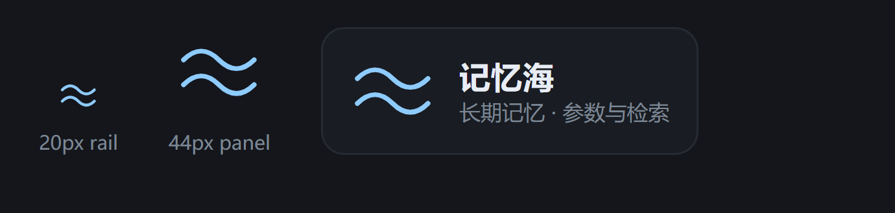

# 记忆海 · 大肥鱼中枢 (dsh-memory-sea)

> 不是 RAG，是一片会遗忘的海——[DeepSeek Harness](https://github.com/deepseek-ai/deepseek-harness) 侧栏插件。每条记忆有自己的半衰期（人格 180 天、事件 10 天），检索按「相似度 × 能量」排序，久未提起的重要事不会沉底。

上下文会被压缩。压缩之后，它只剩印象——而印象是会骗人的。

记忆海不解决「存不下」，它解决「想不起来」：每条记忆有类型、有能量、有半衰期，检索时按「相似度 × 能量」浮上来。这一页是它的控制台：看状态、搜记忆、调衰减、跑夜间体检。

它本身不做记忆——它给你已有的记忆脚本（写入 / 衰减 / 检索）一个能点的界面，和一个能问的入口（给 agent 两个工具）。记忆数据全程留在本机，不出网络。



---

## 功能

| 区块 | 能干什么 |
|---|---|
| **状态** | 长期记忆条数、语义索引新鲜度、参数版本、当前阈值 |
| **检索** | 一句话自然语言 → 走 `mem_recall.py` 的「相似度 × 能量」排序，出 tier / score / 能量 / 日期 |
| **半衰期** | 5 档记忆类型的天数 + 唤醒门槛 / 轻提门槛，改完保存（带夹紧保护） |
| **操作** | 跑一次夜间体检（后台无窗口）· 打开星图 · 刷新 |
| **最近记忆** | 按时间倒序 12 条，带 `scope` 标签 |

三处入口，随宿主形态自适应：

1. **左侧栏图标**（`sidebar.panellist`）→ 点一下，中间主区域整页显示
2. **右侧栏 tab**（`sidebar.right.pane.tab`，kind = `memory-sea`）→ 缩在右栏里跟着会话走
3. **会话标题栏按钮**（`conversation.session.header.utilities`）+ 会话 View 页签 → 右栏服务缺失时的兜底

给 agent 的工具：

- `memory_sea_status` — 看参数 / 条数 / 索引 / 体检摘要
- `memory_sea_recall(query, items?)` — 语义检索 1–12 条

---

## 由来

这套东西不是先有架构再找场景的，是被一个很具体的问题逼出来的：**长对话会把"上次说过什么"弄丢。**

上下文会被压缩，压缩之后模型就只能凭印象说话。一开始的解法很土——每天把结论写进几个 Markdown 文件（交接、摘要、24 小时回顾、自我小结），靠脚本 + 手工维护。它管用，但很快撑不住：

- 文件是线性堆的，越写越长，想翻回原话只能靠 `grep`；
- 重要但很久没提起的事，会安静地沉到底部；
- 记忆"多"不等于记忆"对"，硬塞进上下文反而更乱。

于是有了记忆海，一条一条长出来：

| 版本 | 那一步解决的问题 |
|---|---|
| **v1.0** | 把自由文本换成 JSONL，每条带类型和能量；夜间任务串起「情绪 → 衰减 → 合并 → 星图 → 体检」 |
| **v1.3** | 检索不再只看相似度，改成 `score = 相似度 × (0.6 + 0.4 × 能量)`——久未提起的重要事不再沉底；同时加预算装箱（一次最多几条、几个字）与近重复去重 |
| **v1.5** | 线索唤醒三态：`[提]` / `[轻提]` / `[沉默]`，并把"想起 ≠ 要说"写成规则 |
| **本插件 0.1.0** | 把上面这套变成能点的面板 + 两个给 agent 用的工具 |

## 设计上的几个决定

**1. 遗忘是功能，不是 bug。**
不同的记忆该有不同的保质期：人格与关系按 180 天衰减，决策/约定 90 天，偏好 45 天，事实 30 天，一次性事件 10 天。全都永久保留，等于没有"重要"这件事。

**2. 用"能量"，不用"重要度"。**
重要度是写进去那一刻的判断，能量是**今天的相关性**——被反复命中就升温，长期无人问津就降温。检索时按 `相似度 × 能量` 排序，而不是按"当初标了几颗星"。

**3. 预算是硬约束。**
记忆再准，一次也只能喂几条进来（默认 2–3 条、600 字以内）。宁缺毋滥：两条对的，好过十条似是而非的。

**4. 克制比召回更值钱。**
"想起"不等于"该说"。所以有三个档位：确定就自然带一句、模糊就用「好像/记得」的口吻、翻不到原文就当没想起来。宁可沉默，也不要把旧事硬塞进对话。

## 为什么做成侧栏面板

记忆的**写入**应该发生在对话里（agent 判断什么值得记）；但记忆的**治理**——参数量级、索引新不新鲜、衰减跑没跑、体检报告长什么样——需要一个看得见的地方。

所以这个面板是个控制台，不是聊天入口：五档半衰期能直接改、夜间任务一键跑、体检摘要一眼看完。半夜自动跑的那套东西，没有人看着是会跑偏的。

## 图标：两道波

侧栏图标只有 20px。这个尺寸下能立住的形状必须极简——两根线、无填充、线宽随尺寸自适应即可。选波浪而不是鲸鱼，是因为**海比鲸大**：这个插件管的是那一整片记忆，不是其中某一条。

---

## 安装

### 方式 A：本地目录（推荐，改完就能热重载）

```powershell
# 1) 放进任意目录，例如 D:\QQBot\plugins\dsh-memory-sea
# 2) 运行时注入（免重启，立即生效）
#    在 DSH 会话里让 agent 调用 dev_inject_plugin("D:\\QQBot\\plugins\\dsh-memory-sea")
# 3) 改了代码之后
#    dev_reload_package("dsh-memory-sea")
```

### 方式 B：装配进 profile（重启后仍在）

```powershell
# 在 DSH 会话里调用：
#   dev_install_package("D:\\QQBot\\plugins\\dsh-memory-sea")
# 或走插件管理器：plugin_manager  action=install_bundle  target=<绝对路径>
```

### 方式 C：npm 包（tgz）

```powershell
# 打包
cd D:\QQBot\plugins\dsh-memory-sea
npm pack --pack-destination .\dist

# 装进 profile（profile 根目录执行，注意别手动改 package.json）
#   dsh plugin add <tgz 绝对路径>
```

### 方式 D：从本仓库直接装

```powershell
git clone https://github.com/kuroi-kid/dsh-memory-sea.git
# 然后把 harness 指向该目录：
#   dev_inject_plugin("...\\dsh-memory-sea")          # 运行时注入，免重启
#   dev_install_package("...\\dsh-memory-sea")        # 装配进 profile，重启后仍在
```

仓库里只有手写的 `lib/*.js` 与资源，克隆下来即可用，不需要 `npm install`。

> **不要**用 `npm run build` 覆盖 `lib/index.js` / `lib/client.js`——这两个是手写源（见「开发」）。

---

## 配置

Host 侧读三个环境变量（不传就用默认值）：

| 环境变量 | 默认值 | 作用 |
|---|---|---|
| `DSH_MEMORY_SEA_DIR` | `D:\QQBot\mem` | 记忆库目录 |
| `DSH_MEMORY_SEA_PYTHON` | `D:\QQBot\SeedVC\.venv\Scripts\python.exe` | 跑脚本的 Python |
| `DSH_MEMORY_SEA_STAR` | `http://127.0.0.1:4173` | 星图页面地址 |

### 它期望的目录结构

```
<MEM_DIR>/
  memory_config.json     # 参数（本插件会写它）
  memory_status.md       # 体检报告（读）
  longterm.jsonl         # 长期记忆，每行一个 { ts, scope, text, importance, date, tier? }
<MEM_DIR>/../tools/
  mem_nightly.py         # 「跑一次」调的脚本（情绪 → 衰减 → 星图 → 自调 → 体检）
  mem_recall.py          # 「检索」调的脚本，必须支持 `--json --items N`
```

`mem_recall.py --json` 需要输出形如：

```json
{ "query": "...", "items": [ { "text": "...", "tier": "decision", "score": 0.47, "energy": 0.7, "date": "2026-10-30" } ], "chars": 117 }
```

---

## 使用说明

1. 刷新页面，左侧栏那排图标里点「波浪」图标（找不到就用会话标题栏右侧那颗按钮）。
2. **状态卡**先确认两件事：条数对不对、索引是不是「新鲜」。索引不新鲜先点「跑一次」。
3. **检索**：像跟人说话一样问（"上次那个修插件的事"），回车。约 5 秒（本地向量模型冷启动），别连点。
4. **半衰期**：数字是「多少天后能量减半」。人格/关系 180 天、决策 90 天、偏好 45 天、事实 30 天、事件 10 天是起点值。改超范围会被自动夹回（各档 ±40%、阈值 ±30%），返回里会告诉你夹到多少。
5. **保存参数**会写 `memory_config.json` 并把 `version` +1；下次脚本运行才生效。
6. **跑一次**是后台静默起 `mem_nightly.py`（不会弹黑框），跑完点「刷新」看结果。
7. **最近记忆**只读，用于自查「记忆海里到底灌了什么」。

---

## HTTP 接口（面板用的，也可自己调）

前缀 `/@dsh-external/dsh-memory-sea/api`

| 方法 | 路径 | 说明 |
|---|---|---|
| GET | `/status` | 参数 + 条数 + 索引 + `memory_status.md` 全文 |
| GET | `/recent?n=12` | 最近 N 条长期记忆（按 ts 倒序，n ≤ 50） |
| GET | `/recall?q=<text>&items=5` | 语义检索（items ≤ 12），失败带 `error` |
| POST | `/config` | 写参数，body 形如 `{ "halflife": {...}, "hit_keep": 0.45, "soft_energy": 0.55 }` |
| POST | `/run` | 后台起 `mem_nightly.py` |
| GET | `/page` | 同一套功能的独立 HTML 页（不需要 Web UI 时用） |

---

## 注意事项

- **它会写文件**：`/config` 改 `memory_config.json`，`/run` 可能改 `longterm.jsonl`（衰减 / 合并）。第一次用之前把 `mem/` 备份一次，或用 git 管起来。
- **只在本地开**：这些接口没有鉴权，别把 Harness 的 webserver 暴露到公网。记忆里可能有私人内容。
- **检索慢是正常的**：每次 spawn 一次 Python 并加载本地向量模型，约 5 秒；脚本 30 秒没返回会被 kill 并报超时。
- **路径写死是默认值**：换机器 / 换 Python，用那三个环境变量改，不要改代码。
- **别用 `npm run build`**：`lib/*.js` 是手写产物（无构建步骤），`tsc` 会把它覆盖成半成品。`src/` 只是参考稿。
- **客户端要能被加载**：`lib/client.js` 必须配合 `package.json` 的 `exports["./client"]` 与 `dsh.client`（`platform: web`）才会注册；缺任一项，面板不会渲染。

### 排查

| 症状 | 原因 / 改法 |
|---|---|
| 侧栏没有图标 | 宿主没声明 `sidebar.panellist`，或本插件 `client` 没注册：看 `client ✓`；换标题栏按钮 |
| 面板白屏 | 客户端 bundle 没加载 → 重新 `dev_reload_package` 后刷新页面 |
| 检索一直报 400 | query 解析问题；`/recall?q=test` 手工试 |
| 检索结果为乱码 | 缺 `PYTHONIOENCODING=utf-8`（本插件 spawn 时已带） |
| 条数为 `?` | `memory_status.md` 还没生成，点「跑一次」 |

---

## 开发

```
lib/index.js    host 侧（手写 ESM，无构建）：webserver 路由 + 两个工具
lib/client.js   浏览器侧（手写 window.__ModuleLoader__ bundle）：图标 + 面板 + 三处槽位注册
src/            参考稿（不参与运行）
assets/         图标与预览
```

改完 `node --check lib/*.js`，然后 `dev_reload_package("dsh-memory-sea")`。视觉改动建议先渲一张预览图自查（`assets/logo-preview.html` 用无头浏览器截图即可）。

## License

BSD-3-Clause

---

## English TL;DR

`dsh-memory-sea` is a DeepSeek Harness sidebar plugin that turns a **local JSONL long-term-memory store** into a clickable panel: status, semantic recall, half-life tuning, nightly job trigger, star-map link. Two agent tools (`memory_sea_status`, `memory_sea_recall`) come with it. Everything runs locally; no memory content leaves the machine.

Install with `plugin_manager`/`dev_inject_plugin` (directory) or `dsh plugin add <tgz>`. Configure via `DSH_MEMORY_SEA_DIR` / `DSH_MEMORY_SEA_PYTHON` / `DSH_MEMORY_SEA_STAR`. Do **not** run `npm run build` — `lib/*.js` are hand-written and building overwrites them.
